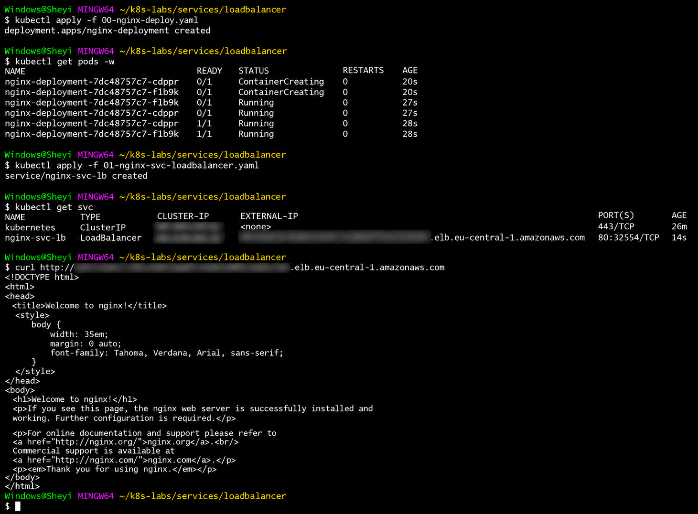

# Kubernetes LoadBalancer Service on AWS EKS

This project demonstrates how I deployed an Nginx application to **Amazon EKS** and exposed it publicly using a Kubernetes `LoadBalancer` Service backed by an **AWS Network Load Balancer (NLB)**.

The project builds on my previous Kubernetes Services work with `ClusterIP` and `NodePort`, but moves the workload from a local `kind` cluster to a real AWS-managed Kubernetes environment.

---

## Project Architecture

```text
Internet
   |
   v
AWS Network Load Balancer
   |
   v
Kubernetes LoadBalancer Service
   |
   v
Nginx Pods
```

---

## Technologies Used

- Amazon Web Services (AWS)
- Amazon Elastic Kubernetes Service (EKS)
- Kubernetes
- AWS Network Load Balancer
- AWS CLI
- eksctl
- kubectl
- Nginx
- Git
- GitHub

---

## Project Structure

```text
kubernetes-eks-loadbalancer-lab/
│
├── 00-nginx-deploy.yaml
├── 01-nginx-svc-loadbalancer.yaml
├── images/
│   └── eks-loadbalancer-success.png
│
└── README.md
```

---

## Objective

The goal of this project was to understand how a Kubernetes `LoadBalancer` Service works in a real cloud environment.

I wanted to verify how Kubernetes interacts with AWS to provision an external load balancer and route public traffic to application Pods running inside an Amazon EKS cluster.

The lab also allowed me to combine several Kubernetes concepts I had previously worked with independently, including:

- Deployments
- Replica management
- Rolling updates
- Readiness probes
- Liveness probes
- Resource requests and limits
- Labels and selectors
- Kubernetes Services
- Cloud load balancing

---

# 1. Create the Amazon EKS Cluster

I created an Amazon EKS cluster using `eksctl`.

```bash
eksctl create cluster --name eks-lb-lab --region eu-central-1 --enable-auto-mode
```

The cluster was created in the AWS Frankfurt region:

```text
eu-central-1
```

EKS Auto Mode was enabled so AWS could manage several infrastructure components required by the Kubernetes cluster.

After the cluster was created, I configured `kubectl` to communicate with it.

```bash
aws eks update-kubeconfig --region eu-central-1 --name eks-lb-lab
```

I then verified the active Kubernetes context.

```bash
kubectl config current-context
```

Cluster connectivity can also be checked with:

```bash
kubectl get nodes
```

---

# 2. Create the Nginx Deployment

The application was deployed using a Kubernetes `Deployment`.

I configured two Nginx replicas to provide redundancy and demonstrate how a Kubernetes Service can route traffic to multiple application Pods.

The Deployment also includes:

- Two replicas
- RollingUpdate deployment strategy
- Readiness probe
- Liveness probe
- CPU resource requests
- CPU resource limits

The Deployment manifest is stored in:

```text
00-nginx-deploy.yaml
```

---

## Deployment Manifest

```yaml
apiVersion: apps/v1
kind: Deployment

metadata:
  name: nginx-deployment
  labels:
    app: nginx

spec:
  replicas: 2

  selector:
    matchLabels:
      app: nginx

  strategy:
    type: RollingUpdate
    rollingUpdate:
      maxSurge: 1
      maxUnavailable: 0

  template:
    metadata:
      labels:
        app: nginx

    spec:
      containers:
        - name: nginx
          image: nginx:1.21.1

          ports:
            - containerPort: 80

          readinessProbe:
            httpGet:
              path: /
              port: 80
            initialDelaySeconds: 2
            periodSeconds: 5
            timeoutSeconds: 1
            failureThreshold: 3

          livenessProbe:
            httpGet:
              path: /
              port: 80
            initialDelaySeconds: 10
            periodSeconds: 10
            timeoutSeconds: 1
            failureThreshold: 3

          resources:
            requests:
              cpu: "100m"
            limits:
              cpu: "200m"
```

---

# 3. Deploy the Application

I applied the Deployment using:

```bash
kubectl apply -f 00-nginx-deploy.yaml
```

Kubernetes created the Deployment successfully.

I then monitored the Pods using:

```bash
kubectl get pods -w
```

The Pods initially moved through states such as:

```text
ContainerCreating
```

and:

```text
Running
```

before eventually becoming fully ready:

```text
1/1 Running
```

The `-w` option allows changes to the Pods to be watched in real time.

Watch mode can be stopped using:

```text
Ctrl+C
```

---

# 4. Readiness Probe

The Deployment contains a Kubernetes readiness probe.

```yaml
readinessProbe:
  httpGet:
    path: /
    port: 80
  initialDelaySeconds: 2
  periodSeconds: 5
  timeoutSeconds: 1
  failureThreshold: 3
```

The readiness probe checks whether the Nginx application is ready to receive traffic.

If the readiness probe fails, Kubernetes should stop routing normal Service traffic to that Pod until it becomes ready again.

This helps prevent requests from being sent to an application instance that is running but not yet capable of serving traffic correctly.

---

# 5. Liveness Probe

The Deployment also contains a liveness probe.

```yaml
livenessProbe:
  httpGet:
    path: /
    port: 80
  initialDelaySeconds: 10
  periodSeconds: 10
  timeoutSeconds: 1
  failureThreshold: 3
```

The liveness probe checks whether the application is still functioning.

If the probe repeatedly fails, Kubernetes can restart the container.

This provides a level of automatic recovery when an application becomes unhealthy.

---

# 6. Resource Requests and Limits

CPU resource requests and limits were also configured.

```yaml
resources:
  requests:
    cpu: "100m"
  limits:
    cpu: "200m"
```

The CPU request tells Kubernetes how much CPU should be reserved when scheduling the container.

The CPU limit defines the maximum amount of CPU the container is allowed to consume.

This helps Kubernetes schedule workloads more effectively and prevents a container from consuming unlimited CPU resources.

---

# 7. Create the LoadBalancer Service

After the Nginx Pods were running, I created a Kubernetes `LoadBalancer` Service.

The Service manifest is stored in:

```text
01-nginx-svc-loadbalancer.yaml
```

The Service exposes the Nginx application externally through AWS.

---

## LoadBalancer Service Manifest

```yaml
apiVersion: v1
kind: Service

metadata:
  name: nginx-svc-lb
  annotations:
    service.beta.kubernetes.io/aws-load-balancer-scheme: internet-facing

spec:
  type: LoadBalancer

  loadBalancerClass: eks.amazonaws.com/nlb

  selector:
    app: nginx

  ports:
    - name: http
      protocol: TCP
      port: 80
      targetPort: 80
```

---

# 8. Understanding the Service Configuration

The following setting defines the Kubernetes Service type:

```yaml
type: LoadBalancer
```

This tells Kubernetes that the application should be exposed through an external load balancer.

The AWS-specific annotation:

```yaml
service.beta.kubernetes.io/aws-load-balancer-scheme: internet-facing
```

configures the AWS load balancer as internet-facing.

The following configuration specifies the AWS Network Load Balancer class:

```yaml
loadBalancerClass: eks.amazonaws.com/nlb
```

The Service uses this selector:

```yaml
selector:
  app: nginx
```

The Nginx Pods created by the Deployment have the corresponding label:

```yaml
labels:
  app: nginx
```

This allows the Service to discover the correct backend Pods.

---

# 9. Service Port and Target Port

The Service exposes port `80`.

```yaml
port: 80
```

The Service then forwards traffic to port `80` on the Nginx Pods.

```yaml
targetPort: 80
```

The traffic flow is therefore:

```text
AWS Load Balancer
       |
       v
Service Port 80
       |
       v
Target Port 80
       |
       v
Nginx Container
```

---

# 10. Apply the LoadBalancer Service

I created the Service using:

```bash
kubectl apply -f 01-nginx-svc-loadbalancer.yaml
```

The Service was successfully created.

I then checked the Kubernetes Services using:

```bash
kubectl get svc
```

The output showed the Nginx Service with:

```text
TYPE
LoadBalancer
```

AWS then provisioned a Network Load Balancer and returned an AWS DNS hostname under the Kubernetes `EXTERNAL-IP` field.

---

# 11. AWS External Endpoint

One useful observation from this project was how AWS represents the external endpoint.

Instead of necessarily displaying a single public IP address, the Kubernetes `EXTERNAL-IP` field returned an AWS load balancer DNS hostname.

It follows a format similar to:

```text
xxxxxxxxxxxxxxxx.elb.eu-central-1.amazonaws.com
```

The exact hostname used during the lab has been redacted from screenshots and documentation.

The AWS-provided DNS hostname should normally be used to access the application rather than depending on individual IP addresses behind the load balancer.

---

# 12. Test External Connectivity

After AWS provisioned the Network Load Balancer, I tested the application externally using `curl`.

```bash
curl http://<AWS-LOAD-BALANCER-DNS>
```

The request successfully returned the Nginx HTML page.

Part of the response included:

```html
<!DOCTYPE html>
<html>
<head>
<title>Welcome to nginx!</title>
</head>
```

This confirmed that external traffic was successfully reaching the application running inside the EKS cluster.

---

# 13. End-to-End Traffic Flow

The complete request path is:

```text
External Client
      |
      v
Internet
      |
      v
AWS Network Load Balancer
      |
      v
Kubernetes LoadBalancer Service
      |
      v
Selector: app=nginx
      |
      +---------------------+
      |                     |
      v                     v
Nginx Pod 1             Nginx Pod 2
Port 80                 Port 80
```

The user does not need to know the individual Pod IP addresses.

The Kubernetes Service provides a stable networking layer between the AWS load balancer and the application Pods.

---

# 14. How the Kubernetes Components Work Together

This project helped connect several Kubernetes concepts.

## Deployment

The Deployment maintains the required number of application replicas.

```text
Deployment
    |
    v
ReplicaSet
    |
    +----------+
    |          |
    v          v
Pod 1        Pod 2
```

If one of the Pods is deleted or fails, the Deployment can create another Pod to maintain the desired replica count.

---

## Readiness Probe

The readiness probe determines whether a Pod should receive application traffic.

```text
Pod Running
    |
    v
Readiness Probe
    |
    +---- Passed ----> Receive Service Traffic
    |
    +---- Failed ----> Removed From Ready Endpoints
```

---

## Liveness Probe

The liveness probe helps identify containers that have become unhealthy.

```text
Container
    |
    v
Liveness Probe
    |
    +---- Healthy ----> Continue Running
    |
    +---- Failed Repeatedly ----> Restart Container
```

---

## Kubernetes Service

The Service provides stable access to Pods.

Applications do not need to communicate directly with changing Pod IP addresses.

```text
Client
   |
   v
Service
   |
   +-----------+
   |           |
   v           v
Pod 1        Pod 2
```

---

## AWS Network Load Balancer

AWS provides the external entry point.

```text
Internet
   |
   v
AWS NLB
   |
   v
Kubernetes Service
   |
   v
Application Pods
```

---

# 15. ClusterIP vs NodePort vs LoadBalancer

This project followed earlier hands-on work with Kubernetes `ClusterIP` and `NodePort` Services.

Understanding the differences between the Service types helped make the purpose of `LoadBalancer` clearer.

---

## ClusterIP

A `ClusterIP` Service provides stable internal access to Pods from inside the Kubernetes cluster.

```text
Internal Client
      |
      v
ClusterIP Service
      |
      v
Pods
```

Example:

```yaml
type: ClusterIP
```

Typical use cases include communication between backend applications, APIs, databases and other internal services.

---

## NodePort

A `NodePort` Service exposes an application through a port on the Kubernetes nodes.

```text
External Client
      |
      v
Node IP : NodePort
      |
      v
Kubernetes Service
      |
      v
Pods
```

Example:

```yaml
type: NodePort
```

NodePort normally uses ports within the Kubernetes NodePort range.

---

## LoadBalancer

A `LoadBalancer` Service integrates with the cloud environment to provide an external load balancer.

```text
Internet
   |
   v
Cloud Load Balancer
   |
   v
Kubernetes Service
   |
   v
Pods
```

Example:

```yaml
type: LoadBalancer
```

In this project, AWS provided a Network Load Balancer.

---

# 16. Service Type Progression

The Kubernetes Service concepts demonstrated so far can be viewed as:

```text
ClusterIP
   |
   | Internal cluster access
   v
NodePort
   |
   | Access through Kubernetes node ports
   v
LoadBalancer
   |
   | External cloud load balancer
   v
Internet-accessible application
```

---

# 17. Difference Between Local Kubernetes and AWS EKS

My earlier Kubernetes networking labs were performed locally using `kind`.

A local `kind` cluster does not automatically have a cloud provider available to provision a real external load balancer.

A `LoadBalancer` Service in such an environment may remain in a state such as:

```text
EXTERNAL-IP
<pending>
```

On Amazon EKS, Kubernetes can integrate with AWS infrastructure.

The same Kubernetes concept can therefore result in AWS provisioning an external Network Load Balancer.

```text
Local kind

Kubernetes Service
      |
      v
No cloud load balancer provider
      |
      v
External endpoint may remain pending
```

Compared with:

```text
Amazon EKS

Kubernetes Service
      |
      v
AWS integration
      |
      v
AWS Network Load Balancer
      |
      v
Public endpoint
```

---

# 18. AWS DNS vs Public IP

Another useful difference I observed was how cloud providers may expose LoadBalancer Services differently.

An Azure example may display a public IP address directly.

AWS commonly provides a DNS hostname for its load balancer.

Example:

```text
xxxxxxxx.elb.eu-central-1.amazonaws.com
```

The DNS hostname can resolve to one or more IP addresses managed by AWS.

This provides AWS with flexibility to manage the underlying load balancer infrastructure without requiring applications to depend on one individual IP address.

---

# 19. Security Considerations

Before publishing project screenshots or documentation, environment-specific infrastructure information was redacted.

The following information was intentionally removed or blurred where applicable:

- Cluster IP addresses
- Pod IP addresses
- AWS load balancer DNS hostname
- AWS account IDs
- IAM information
- Access keys
- Secret access keys
- Other environment-specific infrastructure information

Credentials should never be committed to GitHub or placed inside application configuration files.

Sensitive credentials should not be stored inside:

```text
README files
Kubernetes manifests
Dockerfiles
Terraform configuration
Application source code
Screenshots
Git repositories
```

AWS access keys should also never be published publicly.

---

# 20. Project Screenshot

The screenshot below shows the application Deployment, Pod startup process, LoadBalancer Service creation and successful external test.



Sensitive infrastructure details have been redacted before publication.

---

# 21. What the Screenshot Demonstrates

The project screenshot captures several stages of the deployment:

```text
kubectl apply -f 00-nginx-deploy.yaml
```

This created the Kubernetes Deployment.

The following command was then used to watch the Pods:

```text
kubectl get pods -w
```

The Pods transitioned through:

```text
ContainerCreating
```

then:

```text
Running
```

and eventually:

```text
1/1 Running
```

The LoadBalancer Service was then created using:

```text
kubectl apply -f 01-nginx-svc-loadbalancer.yaml
```

The Service was inspected using:

```text
kubectl get svc
```

Finally, external connectivity was tested using:

```text
curl http://<REDACTED-AWS-LOAD-BALANCER-DNS>
```

The returned Nginx HTML confirmed successful end-to-end connectivity.

---

# 22. Commands Used

## Verify AWS Authentication

```bash
aws sts get-caller-identity
```

---

## Create the EKS Cluster

```bash
eksctl create cluster --name eks-lb-lab --region eu-central-1 --enable-auto-mode
```

---

## Configure kubectl

```bash
aws eks update-kubeconfig --region eu-central-1 --name eks-lb-lab
```

---

## Check Kubernetes Context

```bash
kubectl config current-context
```

---

## Check Nodes

```bash
kubectl get nodes
```

---

## Deploy Nginx

```bash
kubectl apply -f 00-nginx-deploy.yaml
```

---

## Monitor Pods

```bash
kubectl get pods -w
```

---

## Check Pods

```bash
kubectl get pods
```

---

## Create LoadBalancer Service

```bash
kubectl apply -f 01-nginx-svc-loadbalancer.yaml
```

---

## Check Services

```bash
kubectl get svc
```

---

## Describe the LoadBalancer Service

```bash
kubectl describe svc nginx-svc-lb
```

---

## Check EndpointSlices

```bash
kubectl get endpointslices -l kubernetes.io/service-name=nginx-svc-lb
```

---

## Test External Access

```bash
curl http://<AWS-LOAD-BALANCER-DNS>
```

---

# 23. Troubleshooting Encountered

During the project, I encountered and resolved several issues.

## eksctl Was Not Installed

Initially, attempting to create the EKS cluster returned:

```text
bash: eksctl: command not found
```

The issue was resolved by installing `eksctl` and adding its installation directory to the Windows `PATH`.

---

## IAM Permission Error

The first EKS cluster creation attempt also produced an AWS IAM authorization error.

The AWS IAM user had valid credentials but did not initially have sufficient permissions to create and manage the required EKS resources.

After correcting the IAM permissions, `eksctl` was able to create the cluster.

This reinforced the difference between:

```text
Authentication
```

and:

```text
Authorization
```

Successful authentication means AWS recognizes the identity.

Authorization determines which AWS actions that identity is permitted to perform.

---

## EKS Provisioning Time

Creating the EKS environment was not immediate.

`eksctl` waited while AWS CloudFormation provisioned the required infrastructure.

The output included:

```text
waiting for CloudFormation stack
```

The cluster eventually completed successfully.

This showed that creating a managed Kubernetes environment involves provisioning real cloud infrastructure and therefore takes longer than starting a local Kubernetes environment.

---

# 24. Key Learning

The biggest takeaway from this project was understanding the relationship between Kubernetes and the underlying cloud provider.

Kubernetes defines the desired networking behaviour using:

```yaml
type: LoadBalancer
```

AWS then provides the cloud infrastructure required to make that Service externally accessible.

The complete relationship can be represented as:

```text
Kubernetes Deployment
        |
        v
ReplicaSet
        |
        v
Nginx Pods
        |
        v
Readiness Checks
        |
        v
Kubernetes LoadBalancer Service
        |
        v
AWS Network Load Balancer
        |
        v
Internet
```

---

# 25. Kubernetes Concepts Demonstrated

This project demonstrates practical use of:

- Kubernetes Deployments
- ReplicaSets
- Kubernetes Pods
- RollingUpdate strategy
- Readiness probes
- Liveness probes
- CPU requests
- CPU limits
- Kubernetes labels
- Kubernetes selectors
- ClusterIP networking
- NodePort concepts
- LoadBalancer Services
- Endpoint discovery
- External application exposure

---

# 26. AWS Concepts Demonstrated

The project also demonstrates experience with:

- AWS CLI
- Amazon EKS
- eksctl
- AWS IAM permissions
- AWS-managed Kubernetes
- AWS Network Load Balancer
- AWS load balancer DNS endpoints
- Cloud networking
- External service exposure
- Cloud resource provisioning
- Cloud resource cleanup

---

# 27. DevOps Skills Demonstrated

This project demonstrates hands-on use of:

- Kubernetes
- Amazon EKS
- AWS
- Linux command line
- Git Bash
- YAML
- kubectl
- eksctl
- AWS CLI
- Nginx
- Cloud networking
- Application deployment
- Infrastructure troubleshooting
- Service discovery
- Health checks
- Resource management
- Security-conscious documentation
- Git
- GitHub

---

# 28. Cleanup

The AWS resources used for the lab should be removed after testing to avoid unnecessary cloud charges.

First, delete the LoadBalancer Service.

```bash
kubectl delete -f 01-nginx-svc-loadbalancer.yaml
```

Deleting the Service allows AWS to begin removing the associated external load balancer.

Then delete the Nginx Deployment.

```bash
kubectl delete -f 00-nginx-deploy.yaml
```

Finally, delete the EKS cluster.

```bash
eksctl delete cluster --name eks-lb-lab --region eu-central-1
```

The cluster list can then be checked using:

```bash
eksctl get cluster --region eu-central-1
```

---

# 29. Final Result

The project successfully demonstrated external application access through Kubernetes running on AWS.

The final traffic path was:

```text
User
  |
  v
Internet
  |
  v
AWS Network Load Balancer
  |
  v
Kubernetes LoadBalancer Service
  |
  v
Healthy Nginx Pods
```

A request sent to the AWS load balancer endpoint successfully returned:

```text
Welcome to nginx!
```

This confirmed that the Kubernetes workload, Service configuration and AWS load-balancing infrastructure were working together correctly.

---

## Author

Built as part of my hands-on Kubernetes and AWS DevOps practice, with a focus on understanding how Kubernetes networking concepts operate in real cloud environments.